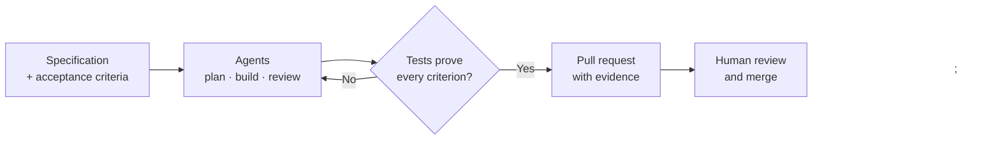

# copilot-engineering-factory

An agentic data engineering factory powered by GitHub Copilot, orchestrating specialised agents to analyse, plan, implement, test and review Jira work items and GitHub issues across data engineering and analytics.

The factory is built on a simple premise: a well-defined specification in, a proven outcome out. Each work item sets out what must be delivered and the acceptance criteria that define success. The work is complete only when tests the agents run prove that every criterion has been met.



## How it works

Work items move through a pipeline of agent stages: **plan → build → review ⇄ fix → ready for human**. A deterministic **Conductor** workflow routes each work item between stages. The agents run as [GitHub Agentic Workflows (gh-aw)](https://github.github.com/gh-aw/) on the Copilot engine and raise a pull request on the **target repository**, which a human approves and merges.

## Documentation

| Doc | Purpose |
|---|---|
| [docs/strategy.md](docs/strategy.md) | Vision, target architecture, roadmap |
| [docs/setup.md](docs/setup.md) | One-off setup of this factory (org admin steps) |
| [docs/onboarding-a-target-repo.md](docs/onboarding-a-target-repo.md) | Repeatable steps to let the factory work on a repo |

## Repository layout

```text
.github/
  agents/       # agent role definitions (*.agent.md)          - V1+
  workflows/    # gh-aw stages (*.md + compiled *.lock.yml), Conductor
  factory/      # config.yml (targets, reviewers, budgets), schemas - V1+
  ISSUE_TEMPLATE/  # work item form
docs/           # strategy and setup guides
scripts/        # repo admin scripts (repo-settings.sh)
```

## Contributing

Commits and PR titles follow [Commitizen](https://commitizen-tools.github.io/commitizen/) using `.cz.toml`. PRs are squash-merged and the **PR title becomes the commit**.

| Type | Use for | Bump |
|---|---|---|
| `feat` | New stage, capability or target | minor |
| `agent` | Agent definition or prompt change | patch |
| `tweak` | Minor change that slightly alters behaviour but is too small to be a feature (e.g. improving a function's accuracy, a slight change to a transform) | patch |
| `fix` `refactor` `test` `build` `chore` `docs` | As usual | patch |

```bash
uv venv .venv && source .venv/bin/activate
uv pip install -r requirements.txt
pre-commit install          # validates commit messages and files locally
```
