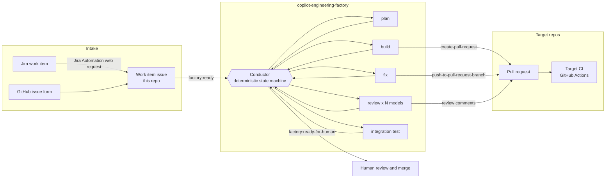

# Strategy and target architecture

## Vision

A factory that takes a Jira work item or GitHub issue (feature or bug) and, **unattended**, analyses it, plans the work, implements it, tests it, raises a PR and gets it through multiple independent reviews. It then hands the PR to a human to approve and merge.

## Methodology

**Contract-driven inputs, constrained non-deterministic execution and objectively verifiable outcomes.**

| Term | Defines | Where it lives in the factory |
|---|---|---|
| Input contract | The structure, conventions and information a work item must contain for the factory to consume it | Work item issue form and `plan` schema |
| Data contract | Source schemas, semantics, quality expectations and obligations between data producers and consumers | Referenced from the target repo (e.g. `<target-repo>/docs/<data-contracts>/`) |
| Specification | What needs to be delivered | Work item body. Refined by the plan stage |
| Acceptance criteria | Verifiable conditions of the target state | Work item. Each criterion gets evidence in the PR and a verdict from the reviewers |
| Engineering constraints | The boundaries within which agents implement autonomously | Target `.github/instructions` and agents, safe outputs, branch protection |
| Verification | Whether the implementation meets the above | Target lint, tests and CI, the integration test stage, reviewer verdicts |

## Principles

1. **Deterministic control, agentic work.** Plain code (the Conductor) decides what happens next. Agents only do work and emit structured results. Routing is never left to a model.
2. **GitHub is the message bus.** Agents hand work to each other through issues, PR comments and labels, using fixed formats. Every hand-off is visible, auditable and can be overridden by a human.
3. **Least privilege.** Agents are read-only. Writes go through gh-aw *safe outputs*, which are validated and scoped. Agents cannot approve, merge or edit target CI.
4. **Humans own the merge.** Branch protection on every target requires human approval.
5. **Separate from targets.** The factory lives here and installs nothing in target repos, so a target's codebase or deployment (e.g. its Databricks bundle) is never coupled to the factory.
6. **Extend through config.** New stages, reviewers, models and targets are added as files and config, not by re-architecting.

## Target architecture



## Components

| Component | Implementation | Notes |
|---|---|---|
| Work item | GitHub issue in this repo (issue form) | Acceptance criteria are mandatory. Reviewers check the PR against them |
| Conductor | Plain GitHub Actions workflow | Reads state, calls the next stage as a reusable workflow (`workflow_call`) and routes on its outputs, enforces round limits, has a stop switch, runs a nightly sweep for stuck items |
| Agent stages | gh-aw workflows (`.github/workflows/*.md` compiled to `*.lock.yml`) | Copilot engine, `copilot-requests: write` (org-billed, no PAT. Personal plans use a `COPILOT_GITHUB_TOKEN` PAT instead), model chosen per stage |
| Agent roles | `.github/agents/*.agent.md` | Selected per stage with `engine.agent` |
| Factory config | `.github/factory/config.yml` | Targets, reviewer list and models, max rounds, AI-credit budgets |
| Contracts | JSON schemas in `.github/factory/schemas/` | `plan`, `verdict`. Exchanged as fenced blocks in comments |
| Cross-repo access | One GitHub App installed on target repos | Short-lived tokens used for checkout, safe outputs and private dependencies |
| Guardrails | Safe outputs, branch protection, `FACTORY_ENABLED` variable, `max-ai-credits`, concurrency per work item | Safe to run unattended |

## Work item lifecycle

```text
factory:ready → factory:planning → factory:building → factory:in-review
        ↑                                          │
        │                     FAIL (round < max) ←─┤
        │             factory:changes-requested → fix ┘
        │                                          │ PASS from all reviewers
        └─ human re-queues ◀─ factory:needs-human       factory:ready-for-human
                             (max rounds / stage failure)
```

## Roadmap

| Iteration | Adds | Done when |
|---|---|---|
| **V1** | Work item form, Conductor (ready → build → ready-for-human), **build** stage (`data-engineer`), PR evidence template, GitHub App onboarding of the first target repo (`<target-repo>`) | An issue labelled `factory:ready` produces a PR in the target repo with lint and tests passing, without anyone acting |
| **V2** | **review** stage (`peer-reviewer`, different model, PR-only context, outputs `VERDICT: PASS/FAIL`), **fix** stage, review loop with round limit | The PR reaches `PASS` or `needs-human` without anyone acting |
| **V3** | Several reviewers from config (all must pass), **plan** stage (analyst / `ticket-refiner`), **integration test** stage against Databricks dev, Jira intake | A Jira ticket goes all the way to a reviewed PR |
| **V4** | Run ledger (rounds, cost, pass rate), weekly improvement agent that proposes prompt changes as `agent:` PRs | The factory measurably improves over time |

## Key decisions

| Decision | Rationale |
|---|---|
| Separate repo using the gh-aw *CentralRepoOps* pattern | Officially supported. Keeps target repos and their deployments (e.g. Databricks bundles) unchanged. Scales to more targets |
| gh-aw rather than the Copilot cloud agent for stages | Version-controlled, model per stage, safe outputs, can run unattended and fully under our control. The cloud agent and Jira app remain for interactive use |
| Copilot engine only, with multiple models | One billing and governance path. Multiple models without extra vendor keys |
| Conductor calls stages as reusable workflows | Events created with the built-in Actions token don't trigger other workflows. A `workflow_call` runs the stage in the Conductor's own run and returns its outputs (e.g. the PR URL) for routing |

## Risks

- gh-aw is evolving (GitHub Next). Mitigation: pin the gh-aw version and review compiled `*.lock.yml` files in PRs.
- Cost from review loops. Mitigation: `max-ai-credits` per stage, max rounds, `FACTORY_ENABLED` stop switch.
- Prompt injection from issue content. Mitigation: only users with write access can trigger, agents are read-only and all writes go through safe outputs.

## North star

Long-term aims as verification matures. These are not commitments for any iteration.

- **Iterating until the specified target state is verified.** Round limits and human escalation give way to verification-led completion. This needs verification that is trustworthy enough: full acceptance-criteria coverage, data-contract checks and integration tests that can be relied on, and a measured record of reviewer accuracy (V4 run ledger).

---

<sub>Future consideration: a BI stage to update impacted Power BI reports after deployment.</sub>
